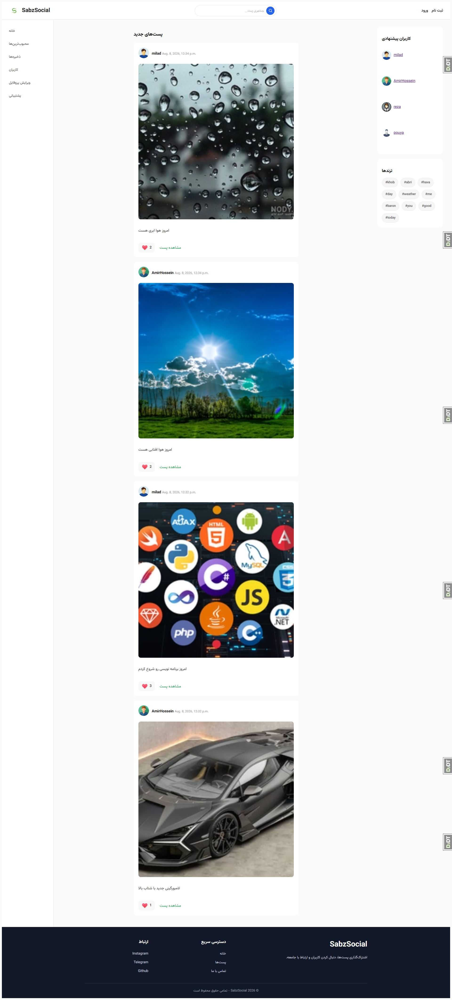
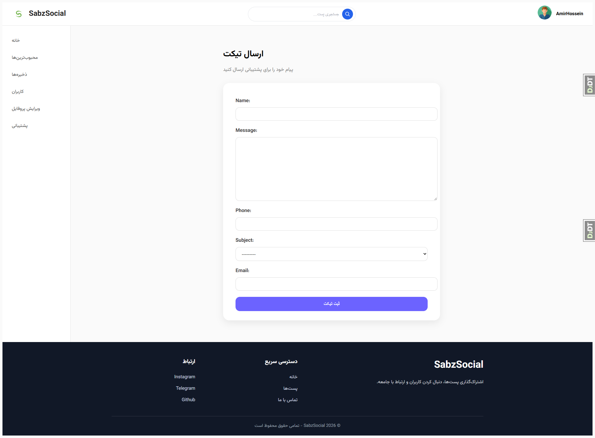
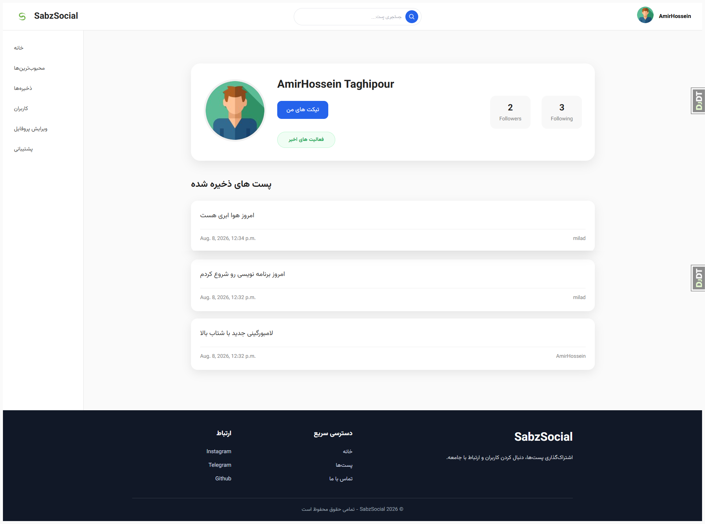
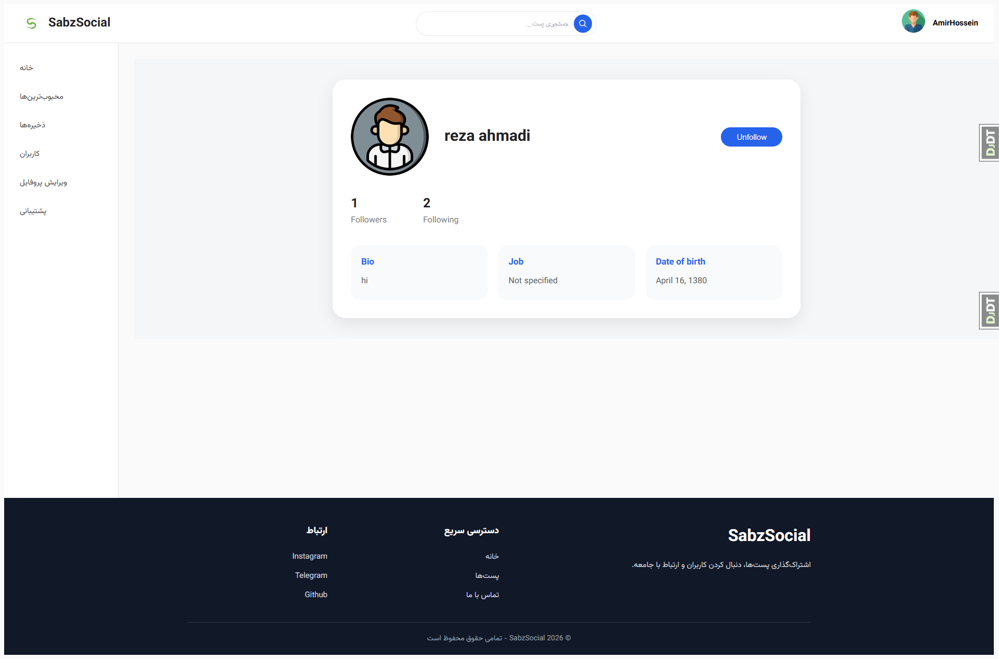

# SabzSocial 🌱

**A Django-powered social networking platform**

SabzSocial is a social networking web application built with Django and PostgreSQL. It provides a platform where users can create profiles, publish posts, interact with other users, and stay connected through social features.

The project focuses on user interaction, content sharing, authentication, and building a structured social networking experience.

---

## ✨ Features

### 👤 User Accounts & Authentication
- Custom user model.
- User registration and authentication.
- Phone-based authentication support.
- Password reset functionality.
- User profile management.
- Profile information and image support.

### 📝 Posts & Content
- Create and manage posts.
- Upload and share images.
- Add tags to posts.
- Browse shared content.
- Share content through social sharing features.

### 🤝 Social Interactions
- Follow and unfollow users.
- Like posts.
- Save posts for later.
- Comment on posts.
- Activity notifications.

### 🔎 Search & Discovery
- Search functionality.
- Database-powered search capabilities.
- Tag-based content organization.

### 📬 Additional Features
- Ticket-based support functionality.
- Email integration.
- Jalali date support.
- Image processing and thumbnail generation.

---

## 🛠️ Technologies Used

| Technology | Purpose |
|---|---|
| Python | Main programming language |
| Django 6 | Backend web framework |
| PostgreSQL | Relational database |
| Pillow | Image processing |
| django-cleanup | Automatic cleanup of unused media files |
| django-taggit | Tag management |
| django-resized | Image resizing |
| easy-thumbnails | Thumbnail generation |
| django-jalali | Jalali date support |
| django-social-share | Social sharing functionality |
| python-dotenv | Environment variable management |

---

## 📁 Project Structure

```text
sabzsocial/
│
├── sabzsocial/
│   ├── settings.py
│   ├── urls.py
│   ├── asgi.py
│   └── wsgi.py
│
├── social/
│   ├── migrations/
│   ├── models.py
│   ├── views.py
│   ├── urls.py
│   ├── forms.py
│   ├── admin.py
│   └── ...
│
├── images/
│   └── ...
│
├── templates/
│   └── ...
│
├── .env.example
├── .gitignore
├── manage.py
└── requirements.txt
```

---

## ⚙️ Installation & Setup

Follow these steps to run SabzSocial locally.

### 1. Clone the Repository

```bash
git clone https://github.com/AmirHossein-1385/social.git
```

Navigate to the project directory:

```bash
cd social
```

### 2. Create a Virtual Environment

**Windows:**

```powershell
python -m venv .venv
.venv\Scripts\activate
```

**Linux / macOS:**

```bash
python3 -m venv .venv
source .venv/bin/activate
```

### 3. Install Dependencies

```bash
pip install -r requirements.txt
```

### 4. Configure Environment Variables

Create a `.env` file in the project root directory.

Use `.env.example` as a reference:

```env
DJANGO_SECRET_KEY=your-secret-key
DJANGO_DEBUG=True
DJANGO_ALLOWED_HOSTS=127.0.0.1,localhost

POSTGRES_DB=social
POSTGRES_USER=your-postgres-user
POSTGRES_PASSWORD=your-database-password
POSTGRES_HOST=127.0.0.1
POSTGRES_PORT=5432

EMAIL_HOST=smtp.gmail.com
EMAIL_PORT=587
EMAIL_HOST_USER=your-email@gmail.com
EMAIL_HOST_PASSWORD=your-gmail-app-password
```

Make sure PostgreSQL is installed and running, and create a database matching your environment configuration.

**Important:** Never commit your `.env` file or expose your secret keys, database credentials, or email app passwords.

### 5. Apply Database Migrations

```bash
python manage.py migrate
```

### 6. Create a Superuser

```bash
python manage.py createsuperuser
```

### 7. Run the Development Server

```bash
python manage.py runserver
```

Open the application in your browser:

```text
http://127.0.0.1:8000/
```

---

## 🔐 Security

Security-sensitive configuration is managed through environment variables.

- Secret keys and credentials are not stored in the repository.
- `.env` is excluded using `.gitignore`.
- `.env.example` provides a template for local configuration.
- Database backup files and private user data are excluded from version control.

For production deployment, use a strong secret key, disable Django debug mode, configure allowed hosts, and use secure database and email credentials.

---

## 🚀 Future Improvements

Potential areas for future development include:

- Automated test coverage.
- Improved API support.
- Real-time notifications.
- Enhanced content discovery.
- Performance optimization.
- Production deployment and monitoring.

---
## Screenshots

### Home Page


### Post Detail


### Ticket


### Profile


### User Information


### Others' Profiles


### Saved Posts


### User Activities

## 👨‍💻 Developer

**AmirHossein Taghipour**

Junior Python Backend Developer

[GitHub Profile](https://github.com/AmirHossein-1385)

---
